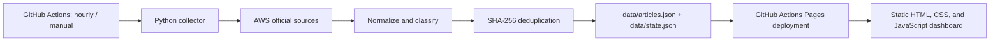
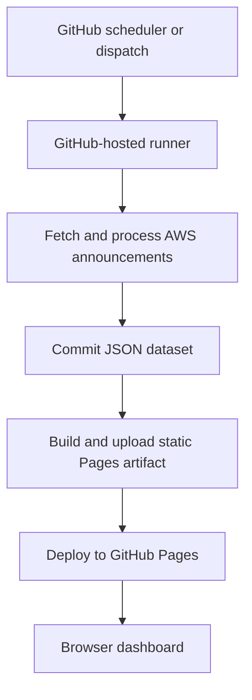

# AWS Release Monitor

A GitHub-native dashboard for AWS What's New, the AWS News Blog, and AWS
Security Bulletins. GitHub Actions collects announcements hourly; the committed
JSON history is published as a static GitHub Pages dashboard.

**No server, cloud infrastructure, local installation, framework, or always-on
process is required.**

## Architecture



## Deployment diagram



## Monitored sources

| Source | URL | Collection |
|---|---|---|
| AWS What's New | <https://aws.amazon.com/new/> | Official announcement page |
| AWS News Blog | <https://aws.amazon.com/blogs/aws/> | Official RSS feed |
| AWS Security Bulletins | <https://aws.amazon.com/security/security-bulletins/> | Official bulletin page |

Add future sources in `SOURCES` in `collector/fetch.py`.

## Features

- Hourly scheduled collection and manual workflow dispatch.
- Title, URL, source, summary, published date, category, and SHA-256 identity.
- Historical retention with duplicate prevention.
- Categories: Release, Upgrade, Security, Bug Fix, Service Update, General
  Announcement.
- Responsive dark dashboard with overview, search, category/source filters,
  sorting, latest updates, security updates, releases, and upgrades.
- Pull-request CI for linting, tests, and JSON Schema validation.

## GitHub Pages instructions

1. Push the project to a GitHub repository.
2. In **Settings → Actions → General → Workflow permissions**, allow repository
   write access so the collector can commit updated JSON.
3. In **Settings → Pages**, select **GitHub Actions** as the deployment source.
4. Run **Actions → Collect AWS announcements → Run workflow**. The same
   workflow deploys the Pages artifact after collection.
5. Open the URL displayed by the `github-pages` environment/deployment. For
   this repository owner, it is expected to be
   <https://Suraj58143.github.io/aws-release-monitor/>.

### If Pages is unavailable while the repository is private

Pages for private repositories depends on the GitHub plan and organization
policy. The current account plan rejects Pages for this private repository, so
collector runs continue but deployment is skipped. When ready to publish, go
to **Settings → General → Danger Zone → Change repository visibility →
Public**. Inspect the repository and its complete Git history for confidential
information first; public visibility exposes both. Then enable Pages with
**GitHub Actions** in **Settings → Pages** and run the collector workflow
again. Public repositories deploy automatically. If private Pages becomes
available under a future plan, set the repository Actions variable
`PAGES_ENABLED=true` to allow deployment without changing visibility.

More detail: [`docs/Setup.md`](docs/Setup.md).

## Troubleshooting

| Symptom | Check |
|---|---|
| Scheduled run is delayed | GitHub may delay scheduled workflows under load; use manual dispatch for an immediate run. |
| A source reports an error | Open the collector run log and inspect `data/state.json`; successful sources still update the dataset. |
| No data was committed | The collector commits only when JSON changes. A successful run may discover no new announcements. |
| Pages deployment is rejected | Verify Pages is enabled with **GitHub Actions**, the repository plan supports its visibility, and the workflow's Pages permissions are available. |
| CI rejects JSON | Validate the relevant file against its schema under `schemas/`; update the schema when the data contract intentionally changes. |
| Dashboard cannot load data | Use the deployed Pages URL or serve the repository over HTTP; `file://` blocks JSON fetches in browsers. |

## Repository layout

```text
.github/workflows/  Scheduled collector, Pages deployment, and PR CI
collector/          Fetching, normalization, classification, storage, site build
dashboard/          Static dashboard assets
data/               Historical announcements and latest run metadata
docs/               Architecture, setup, and roadmap
schemas/            JSON Schema contracts
tests/              Focused collector tests
```

## Data and operation

`data/articles.json` is historical and deduplicated with
`SHA256(title + url)`. `data/state.json` stores per-run and per-source
metadata. Workflows install their own dependencies on GitHub-hosted runners;
no local setup is necessary for normal operation.

See [`docs/Architecture.md`](docs/Architecture.md) and
[`docs/Roadmap.md`](docs/Roadmap.md).
