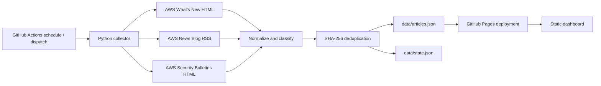
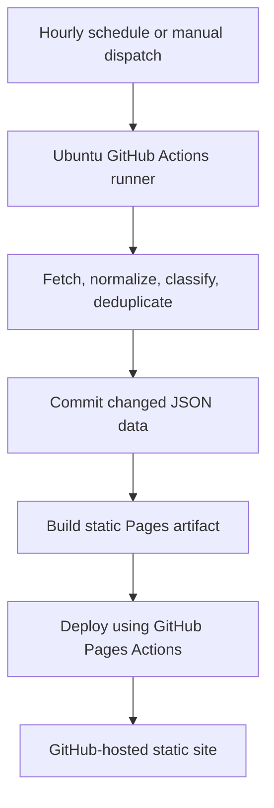

# Architecture

## Data flow

The collector reads each official source independently. A source failure is stored
in the run state without discarding successful-source results; if every source
fails, the run exits without changing the dataset. Article identity is the
SHA-256 digest of the normalized title concatenated with the normalized URL.
Historical articles are retained.

## Deployment

No server, cloud infrastructure, local installation, or long-running process is
needed to operate the deployed platform. GitHub Actions installs the Python
dependencies on each run. The dashboard uses static HTML, CSS, JavaScript, and
the committed JSON dataset; it does not call a runtime API.

## Extension points

- Add a source definition to `SOURCES` in `collector/fetch.py`. RSS/Atom feeds
  use `kind: "rss"` and `feed_url`; HTML pages use `kind: "html"` and a
  `path_pattern`.
- Add categories in `collector/classification.py` and update the dashboard's
  filter options and JSON schema together.
- Keep collector state and dashboard data in the repository so every run is
  reproducible from Git history.

## Permissions

The collector workflow requires `contents: write` to commit data and
`pages: write` plus `id-token: write` to publish the Pages artifact. CI is
read-only.
